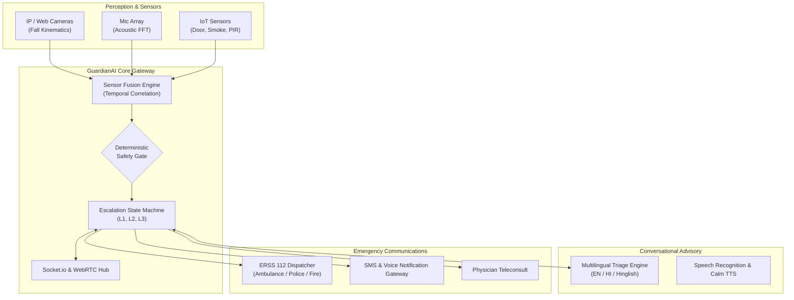

# 🛡️ GuardianAI: Autonomous Home Safety, Health Monitoring & Emergency Response System

**GuardianAI** is a production-oriented, multimodal intelligent digital guardian designed to protect vulnerable household members (children home alone, elderly parents, individuals living alone, spouses) through computer vision kinematics, acoustic distress classification, multi-sensor fusion, and deterministic emergency escalation.

---

## ⚡ Core Capabilities

- **Intelligent Fall & Kinematic Detection**:
  - MoveNet / PoseNet posture tracking analyzing bounding box aspect ratio ($W/H > 1.3$), vertical descent velocity ($V_y > 1.2\text{ m/s}$), and floor-plane dwell time.
  - Client-side privacy-first processing: raw video never leaves device memory without consent.

- **Acoustic Distress & Alarm Classification**:
  - Real-time Web Audio API FFT decomposition.
  - Pinpoints ISO standard 3,120 Hz smoke alarm beeps, sudden transient spikes ($> 4,500\text{ Hz}$ glass break resonance), and distress vocalizations ("Help", "Bachao", "Save me").

- **Deterministic Safety Gate & Escalation Engine**:
  - Critical life-safety actions are strictly rule-bound (not delegated solely to probabilistic LLMs).
  - **LEVEL 1 (Informational)**: Ambient anomaly logs, routine perimeter alerts.
  - **LEVEL 2 (Warning)**: Fall or distress detected; triggers a 30-second audible voice challenge ("Are you okay? Do you need help?").
  - **LEVEL 3 (Critical)**: Fire confirmed, forced breach, or unresponsive user ($30\text{s}$ timeout); triggers 15s panic abort window, alerts all family contacts via SMS/Voice, and executes Emergency 112 dispatch.

- **Emergency Response Support System (ERSS 112) Integration**:
  - Implements national Emergency 112 (India / EU) dispatch protocol with verified GPS coordinates, safe room location, and medical condition dossier (e.g. grandfather's hypertension, child's allergies).
  - Fully transparent, audited simulation mode with real-time dispatch tracking ID and response ETA.

- **Real-Time WebRTC Family Video & Audio**:
  - Peer-to-peer encrypted WebRTC video mesh with local camera/mic streaming.
  - Low-latency signaling via Socket.io with immediate emergency video room link.

- **Multilingual AI Voice Assistant**:
  - Empathetic conversational triage supporting English, Hindi (हिन्दी), and Hinglish.
  - Speech-to-Text and calm Voice Synthesis via Web Speech API with fallback clinical triage patterns.

- **Hardware-Level Privacy Mode & Cryptographic Audit**:
  - Physical & cryptographic stream cutoff with visible status indicators.
  - SHA-256 tamper-evident log chaining for every sensor event, dispatch, and consent change.

---

## 🏗️ System Architecture



---

## 📂 Repository Structure

```
GuardianAI/
├── docs/
│   └── ARCHITECTURE_SPEC.md       # Complete 10-part engineering specification
├── backend/
│   ├── src/
│   │   ├── config/                # DB, Redis/Cache, Socket.io, Env config
│   │   ├── models/                # 14 Schema collection definitions
│   │   ├── routes/                # REST endpoints (auth, household, family, emergency, etc.)
│   │   ├── services/              # Sensor fusion, escalation engine, 112 dispatch, AI triage
│   │   ├── middleware/            # JWT auth, RBAC, privacy enforcement
│   │   └── index.js               # HTTP/WebSocket gateway & static bundle server
│   └── package.json
├── frontend/
│   ├── src/
│   │   ├── components/            # SOC Dashboard, Fall CV, Audio FFT, WebRTC room, Voice AI
│   │   ├── context/               # Auth, Socket, Emergency, Privacy context providers
│   │   ├── services/              # API and WebSocket client
│   │   └── App.jsx                # Single Page Application root
│   ├── vite.config.js
│   ├── tailwind.config.js
│   └── package.json
├── package.json                   # Root monorepo launcher
└── README.md
```

---

## 🚀 Quick Start Guide

### 1. Prerequisites
- Node.js v18+ & npm

### 2. Launching GuardianAI
Run the following from the project root:

```bash
# 1. Install dependencies (if not already installed)
npm run build

# 2. Start the unified GuardianAI Core Server
npm start
```

The system will start listening on **`http://localhost:5001`**.
Navigate to `http://localhost:5001` in your browser to access the complete SOC Dashboard!

For concurrent hot-reloading development:
```bash
# Terminal 1 (Backend API & WebSocket gateway)
npm run dev:backend

# Terminal 2 (Frontend Vite dev server on port 5173)
npm run dev:frontend
```

---

## 🧪 Interactive Evaluation Walkthrough

1. **SOC Overview Dashboard**:
   - Inspect active household sentry, connected peripherals, and ERSS 112 readiness.

2. **Computer Vision & Fall Detection**:
   - Navigate to **"Live Monitoring & CV"**.
   - View real-time kinematics overlay (aspect ratio, vertical descent velocity $V_y$, floor plane line).
   - Click **"Simulate Sudden Fall Kinematics"** to watch the kinematic transitions from `NORMAL_STANDING` $\to$ `SUDDEN_DESCENT` $\to$ `FALL_DETECTED`.

3. **Autonomous Voice Challenge ("Are you okay?")**:
   - When the fall occurs, the system initiates the **Level 2 Warning** dialogue.
   - GuardianAI recites: *"Are you alright? I detected a possible fall. Do you need medical assistance?"*
   - Watch the 30-second countdown bar.
   - Click **"I Am Safe"** to resolve the alert, or **"I Need Help! (Call 112)"** to escalate immediately.

4. **ERSS 112 Emergency Dispatch Dossier**:
   - When escalated or if the 30s timer expires, the **Emergency Dossier** appears displaying the exact payload transmitted: Dispatch ID, GPS Coordinates, Safe Room location, and attached medical history (e.g. grandfather's vertigo, child's allergy) with real-time ETA.

5. **WebRTC Family Video Calling**:
   - Navigate to **"Family & Video Calling"**.
   - Click **"Connect Live Video"** next to any family member to launch the encrypted peer-to-peer video calling room with mic/video toggles.

6. **Multilingual AI Voice Assistant**:
   - Navigate to **"Multilingual Voice AI"**.
   - Switch language between **English**, **हिन्दी**, or **Hinglish**.
   - Test queries like *"Help me, I am feeling very weak"*, *"Someone is trying to open my door"*, or *"Call my son"*.

7. **Hardware Privacy Mode**:
   - Toggle **"Privacy Mode"** in the top navigation header.
   - Notice optical and acoustic capture are instantly blinded in hardware with red slashed indicators.

---

## 🔒 Security & Privacy Guarantees

- **No Continuous Video Storage**: Camera feeds are processed ephemeral-first in client memory; only authorized kinematic snapshots are retained during active emergencies.
- **Tamper-Evident SHA-256 Audit Trail**: Every incident, confirmation, and dispatch is cryptographically chained.
- **Deterministic Override**: Critical emergency actions are governed by deterministic rules, preventing hallucination risks.

---

*GuardianAI — Your Family's Intelligent Digital Guardian.*

